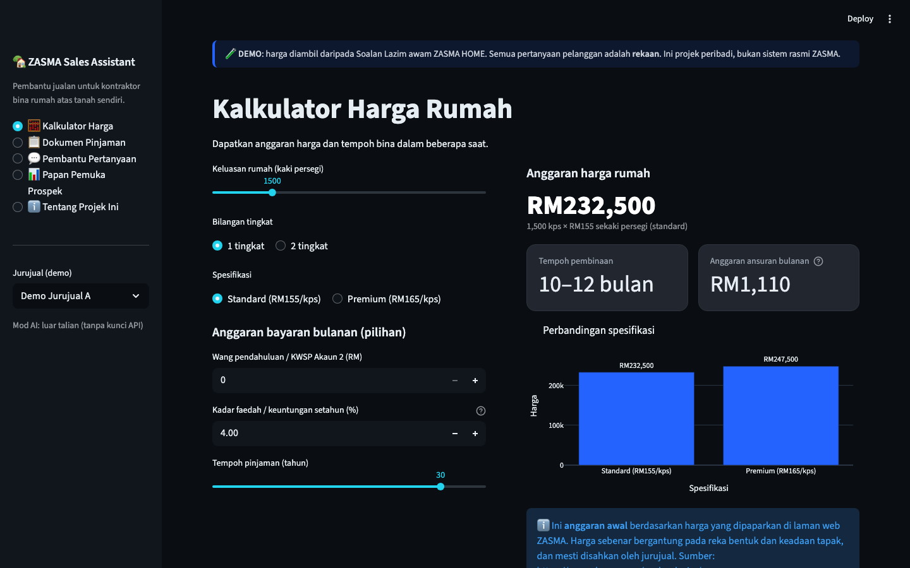
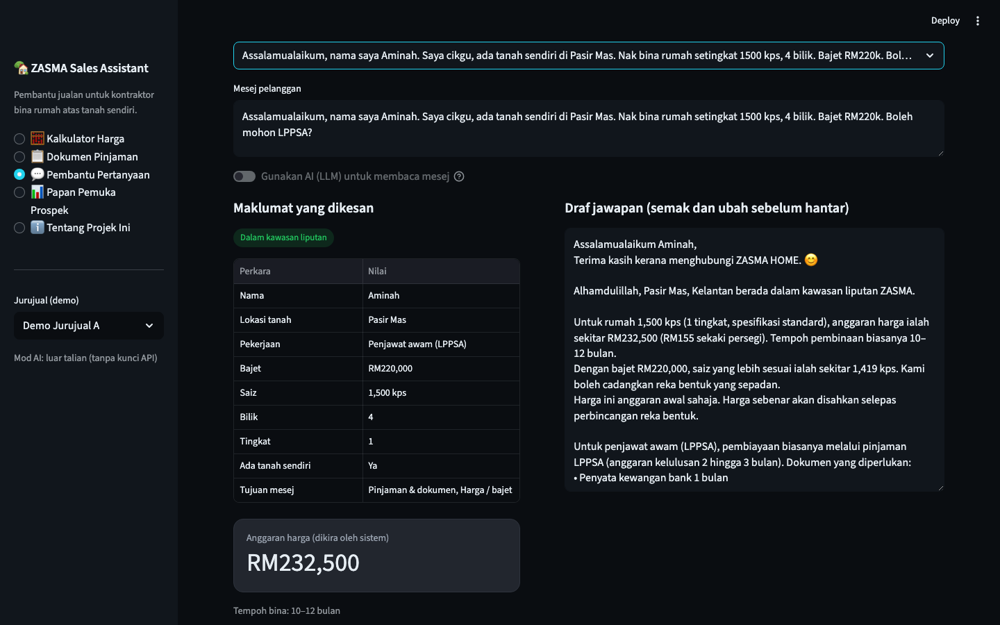
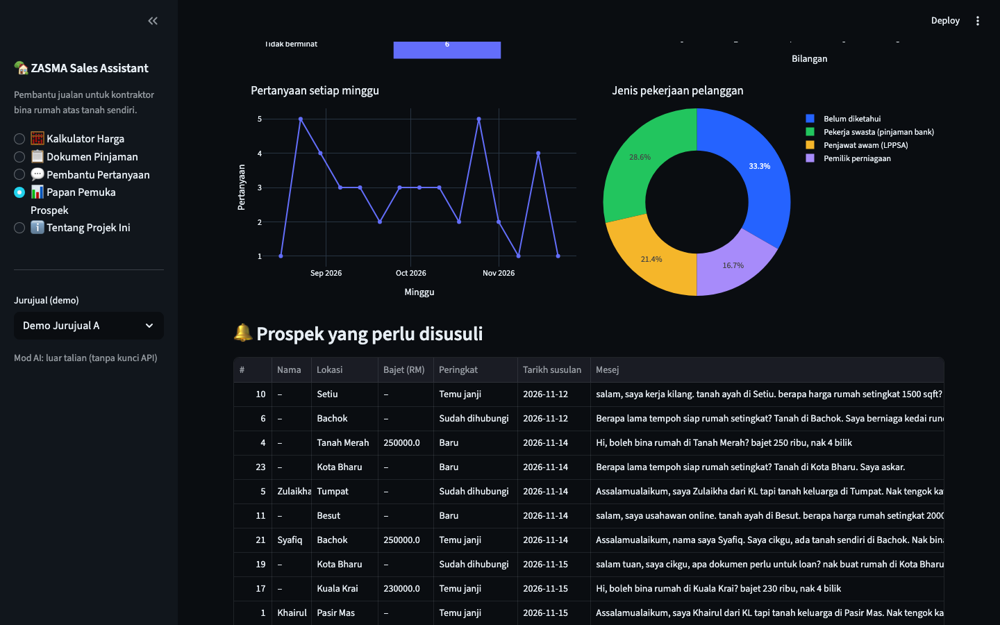

# ZASMA Sales Assistant 🏡

**Pembantu jualan untuk kontraktor bina rumah atas tanah sendiri.**

> ⚠️ **Projek peribadi / demo.** Ini bukan sistem rasmi ZASMA HOME. Harga dan senarai dokumen diambil daripada [Soalan Lazim awam ZASMA](https://zasmahome.com/soalan-lazim/) (diakses 16 Nov 2026). Semua mesej pelanggan dalam demo adalah **rekaan**.

## Masalah yang cuba diselesaikan
Pelanggan selalu bertanya soalan yang sama melalui WhatsApp: *berapa harga, berapa lama siap, boleh buat di kawasan saya, apa dokumen pinjaman yang perlu disediakan.* Jurujual perlu menjawab satu per satu dan menjejak siapa yang perlu disusuli. Kami **menjangkakan** keadaan ini berlaku di ZASMA, tetapi ia belum disahkan dengan pasukan ZASMA.

## Apa yang aplikasi ini buat

| Halaman | Fungsi |
|---|---|
| 🧮 **Kalkulator Harga** | Anggaran harga segera (kps × RM155 standard / RM165 premium), tempoh bina (10–12 atau 12–14 bulan), dan anggaran ansuran bulanan |
| 📋 **Dokumen Pinjaman** | Senarai semak mengikut jenis pekerjaan: penjawat awam (LPPSA), pekerja swasta (bank) atau peniaga. Boleh dimuat turun |
| 💬 **Pembantu Pertanyaan** | Tampal mesej pelanggan. Sistem mengesan lokasi tanah, bajet, saiz, pekerjaan dan tujuan mesej, menyemak kawasan liputan, kemudian menyediakan **draf jawapan** untuk jurujual |
| 📊 **Papan Pemuka Prospek** | Perjalanan prospek, lokasi, trend mingguan dan senarai **prospek yang lewat disusuli** |





## Prinsip reka bentuk
- **Harga sentiasa dikira oleh Python** daripada jadual harga ([src/business_rules.py](src/business_rules.py)), dan tidak pernah direka oleh AI.
- **Tiada mesej dihantar secara automatik.** Jurujual menyemak dan menyunting draf, kemudian menekan "Saya sudah hantar". Tindakan itu direkodkan dalam sejarah prospek.
- **Lokasi tanah diutamakan berbanding tempat kerja.** Contohnya, "Kerja di KL, tanah di Machang" dibaca sebagai Machang.
- **Berfungsi tanpa kunci API** menggunakan pembaca kata kunci. Mod AI (Gemini/OpenAI) adalah pilihan, dan outputnya disahkan semula oleh Python.

## Cara menjalankan
```bash
pip install -r requirements.txt
streamlit run app.py
```
Pangkalan data demo (42 pertanyaan rekaan) dicipta secara automatik pada larian pertama.

Mod AI (pilihan): salin `.env.example` ke `.env` dan isi `GEMINI_API_KEY`. Untuk Streamlit Cloud, letakkan kunci di *App settings → Secrets*.

## Ujian
```bash
pip install pytest && pytest -q
```
11 ujian merangkumi perkara berikut:
- harga sepadan dengan contoh dalam Soalan Lazim (1,500 kps → RM232,500)
- formula ansuran bulanan
- kawasan liputan
- pembacaan mesej, termasuk format bajet dan lokasi tanah berbanding tempat kerja
- draf jawapan
- pengesahan output AI
- aliran pangkalan data

## Struktur
```
app.py                  # UI Streamlit (5 halaman)
src/business_rules.py   # harga, tempoh, liputan, dokumen (dari Soalan Lazim awam)
src/enquiry.py          # baca mesej → maklumat → penilaian → draf jawapan
src/llm.py              # pembaca AI pilihan (Gemini / OpenAI)
src/db.py               # SQLite: prospek + sejarah
src/seed.py             # 42 pertanyaan rekaan untuk demo
tests/test_core.py
```

## Had
- Harga mungkin sudah berubah sejak tarikh akses. Dalam penggunaan sebenar, harga perlu diselenggara oleh ZASMA.
- Pembaca kata kunci mungkin terlepas loghat Kelantan atau ejaan tidak standard. Mod AI membantu, tetapi belum diuji dengan kunci sebenar.
- Tiada integrasi WhatsApp Business API dalam demo ini.
- Streamlit Cloud tidak menyimpan data secara kekal. Data demo akan dimuat semula selepas aplikasi dimulakan semula.

---
Dibina oleh **Muhammad Izzul Fidaey** · [Portfolio](https://izzul-fidaey-portfolio.vercel.app) · [Projek lain: ZASMA Doc Intelligence](https://github.com/Izzul03/zasma-doc-intelligence)
